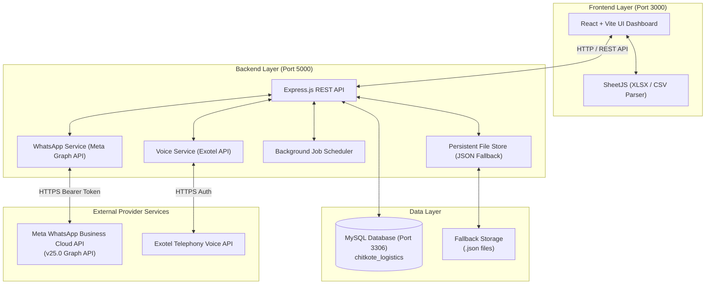

# 🚚 Chitkote Logistics — WhatsApp & Voice Integration Platform
## Technical Architecture & System Design Specification

This document provides a comprehensive overview of the system architecture, technology stack, database schemas, API integrations, and key workflows of the Chitkote Logistics WhatsApp & Voice Integration Platform.

---

## 📍 Table of Contents
1. [Executive Summary](#1-executive-summary)
2. [High-Level Architecture](#2-high-level-architecture)
3. [Technology Stack](#3-technology-stack)
4. [Backend Architecture](#4-backend-architecture)
5. [Frontend Architecture](#5-frontend-architecture)
6. [Database & Storage Architecture](#6-database--storage-architecture)
7. [Meta WhatsApp Cloud API Integration](#7-meta-whatsapp-cloud-api-integration)
8. [Exotel Voice API Integration](#8-exotel-voice-api-integration)
9. [CSV & Excel Data Engine](#9-csv--excel-data-engine)
10. [Port Allocations & Startup Configuration](#10-port-allocations--startup-configuration)

---

## 1. Executive Summary

The **Chitkote Logistics WhatsApp & Voice Integration Platform** is a web-based dispatch and broadcast platform built for **Chitkote Logistics India Private Limited**. It enables logistics managers to:
* Post new freight loads (pickup, delivery, vehicle required, weight, freight rate, contact number).
* Dispatch instant load notifications to drivers via **Meta WhatsApp Cloud API (v25.0)** using approved **UTILITY** templates.
* Perform automated **Exotel Voice Calls** directly to driver mobile numbers.
* Bulk import & export contacts via **CSV and Excel (`.xlsx`, `.xls`)** files with intelligent header matching and phone normalization.
* Manage broadcast recipient groups, schedule delayed dispatches, and track complete delivery audit logs.

---

## 2. High-Level Architecture



---

## 3. Technology Stack

### **Frontend**
* **Core Framework:** React 18
* **Build Tool / Dev Server:** Vite 5
* **Styling:** Tailwind CSS 3 (Dark Mode, Glassmorphism UI tokens)
* **Icons:** `@heroicons/react`
* **File Processing:** `xlsx` (SheetJS v0.18.5)
* **HTTP Client:** `axios`
* **Routing:** `react-router-dom`

### **Backend**
* **Runtime:** Node.js (v24.x)
* **Server Framework:** Express.js 4
* **Database Driver:** `mysql2` (Connection Pool + Promises)
* **HTTP Client:** `axios`
* **Environment Configuration:** `dotenv`
* **Cross-Origin Resource Sharing:** `cors`

### **Database & Fallback Engine**
* **Primary Database:** MySQL 8.0 / MariaDB (Port 3306)
* **Fallback Data Store:** Built-in JSON persistent file storage (`fileStore.js`) for zero-downtime operation if MySQL is offline.

### **External Integrations**
* **Meta WhatsApp Cloud API:** Graph API `v25.0` (WhatsApp Business Account / WABA)
* **Exotel Telephony API:** Voice call dispatches to driver mobile numbers

---

## 4. Backend Architecture

The backend follows a modular Service-Controller-Route architecture:

```text
backend/
├── src/
│   ├── config/
│   │   ├── db.js             # MySQL Connection Pool
│   │   └── initDb.js         # Auto Schema Bootstrap & Database Creation
│   ├── controllers/
│   │   └── contactController.js # Contacts, Inbound & Import Handlers
│   ├── routes/
│   │   └── whatsappRoutes.js  # All API Endpoint Routes
│   ├── services/
│   │   ├── whatsappService.js # Meta API Sending, Template Builder & Fallback Logic
│   │   ├── voiceService.js    # Exotel Voice Call Dispatch Engine
│   │   ├── settingsService.js # Application & API Settings Manager
│   │   └── messageScheduler.js# Background Scheduler for Timed Broadcasts
│   ├── utils/
│   │   └── fileStore.js       # JSON Storage Fallback Handler
│   └── server.js             # Express App Entry Point & Static Dist Server
└── .env                      # Environment Credentials
```

### **Key Backend Services & Capabilities**

1. **WhatsApp Messaging Service (`whatsappService.js`)**
   - Implements `sendMessage`, `queueSend`, `buildLoadNotificationTemplate`, `validateContacts`, and `getTemplates`.
   - Normalizes all incoming phone numbers to 12-digit Indian format (e.g., `919876543210`).
   - Automatically parses message text into structured dynamic parameters:
     - `{{1}}`: Pickup City
     - `{{2}}`: Delivery City
     - `{{3}}`: Vehicle Required
     - `{{4}}`: Shipment Weight
     - `{{5}}`: Freight Rate (numeric format)
     - `{{6}}`: Contact Mobile (strictly 10-digit number)

2. **Graceful Template Fallback Logic**
   - If Meta returns a `404`/`400` error (e.g. template pending review), the backend automatically falls back to an approved alternative UTILITY template (`chitkotelog_load_utility`) to ensure dispatches are never interrupted.

3. **Background Scheduler Service (`messageScheduler.js`)**
   - Polls scheduled dispatches every 60 seconds.
   - Triggers pending broadcast messages automatically when `scheduled_at` timestamp is reached.

---

## 5. Frontend Architecture

The frontend is a single-page React dashboard designed with a modern dark theme and responsive layout.

```text
frontend/
├── public/
│   ├── sample_contacts_template.csv  # Downloadable sample template
│   └── _redirects
├── src/
│   ├── components/
│   │   └── Navbar.jsx                # Global Navigation Bar
│   ├── pages/
│   │   ├── Dashboard.jsx             # Analytics overview, stats, recent logs
│   │   ├── LoadPosting.jsx           # Load creation & posting interface
│   │   ├── Broadcast.jsx            # Bulk message broadcast, quick load generator, group manager
│   │   ├── Contacts.jsx             # Directory, CSV/Excel uploader, Exotel caller
│   │   ├── MessageHistory.jsx       # Complete message audit logs
│   │   ├── Settings.jsx             # Meta WABA & Exotel credentials settings
│   │   └── Login.jsx                # User login screen
│   ├── services/
│   │   └── api.js                   # Central Axios API Service Client
│   ├── App.jsx                      # App Router & Layout Shell
│   └── main.jsx                     # React Root Entry Point
```

---

## 6. Database & Storage Architecture

### **Database Name:** `chitkote_logistics`

```sql
-- 1. Contacts Table
CREATE TABLE IF NOT EXISTS contacts (
  id BIGINT AUTO_INCREMENT PRIMARY KEY,
  name VARCHAR(255) NOT NULL,
  mobile VARCHAR(20) NOT NULL UNIQUE,
  company VARCHAR(255) DEFAULT '',
  city VARCHAR(100) DEFAULT '',
  state VARCHAR(100) DEFAULT '',
  vehicle_type VARCHAR(100) DEFAULT '',
  is_active TINYINT(1) DEFAULT 1,
  created_at TIMESTAMP DEFAULT CURRENT_TIMESTAMP
);

-- 2. Loads Table
CREATE TABLE IF NOT EXISTS loads (
  id BIGINT AUTO_INCREMENT PRIMARY KEY,
  load_id VARCHAR(50) NOT NULL UNIQUE,
  from_city VARCHAR(100) NOT NULL,
  to_city VARCHAR(100) NOT NULL,
  vehicle_type VARCHAR(100) NOT NULL,
  weight VARCHAR(50) DEFAULT '25 Tons',
  freight VARCHAR(50) DEFAULT '42000',
  contact_number VARCHAR(20) DEFAULT '9390003955',
  message_body TEXT,
  status VARCHAR(20) DEFAULT 'ACTIVE',
  created_at TIMESTAMP DEFAULT CURRENT_TIMESTAMP
);

-- 3. Broadcast Groups Table
CREATE TABLE IF NOT EXISTS broadcast_groups (
  id BIGINT AUTO_INCREMENT PRIMARY KEY,
  name VARCHAR(255) NOT NULL,
  created_at TIMESTAMP DEFAULT CURRENT_TIMESTAMP
);

-- 4. Broadcast Group Members Table
CREATE TABLE IF NOT EXISTS broadcast_group_members (
  id BIGINT AUTO_INCREMENT PRIMARY KEY,
  group_id BIGINT NOT NULL,
  contact_id BIGINT NOT NULL,
  FOREIGN KEY (group_id) REFERENCES broadcast_groups(id) ON DELETE CASCADE
);

-- 5. Message History Table
CREATE TABLE IF NOT EXISTS message_history (
  id BIGINT AUTO_INCREMENT PRIMARY KEY,
  recipient VARCHAR(20) NOT NULL,
  message_type VARCHAR(20) DEFAULT 'template',
  message_body TEXT,
  template_name VARCHAR(100) DEFAULT 'new_load_available_utility',
  status VARCHAR(20) DEFAULT 'SENT',
  wamid VARCHAR(255) DEFAULT NULL,
  sent_at TIMESTAMP DEFAULT CURRENT_TIMESTAMP
);

-- 6. Inbound Messages Table
CREATE TABLE IF NOT EXISTS inbound_messages (
  id BIGINT AUTO_INCREMENT PRIMARY KEY,
  mobile VARCHAR(20) NOT NULL,
  sender_name VARCHAR(255) DEFAULT '',
  message TEXT,
  is_saved TINYINT(1) DEFAULT 0,
  created_at TIMESTAMP DEFAULT CURRENT_TIMESTAMP
);
```

---

## 7. Meta WhatsApp Cloud API Integration

### **WABA & Credentials**
* **Business Account ID (WABA ID):** `1568445654798459`
* **Phone Number ID:** `1198488923355389` (`+91 94415 10824`)
* **API Version:** `v25.0` / `v18.0`
* **Base Endpoint:** `https://graph.facebook.com`

### **Approved Active Template Specification**
* **Template Name:** `new_load_available_utility`
* **Category:** `UTILITY`
* **Status:** `APPROVED`
* **Template ID:** `2340656993442192`

#### **Template Structure Body:**
```text
🚛 *New Load Available*

*Load Details:*

📍 *Pickup:* {{1}}
📍 *Delivery:* {{2}}
🚚 *Vehicle Required:* {{3}}
⚖️ *Weight:* {{4}}
💰 *Freight:* ₹{{5}}

📞 *Contact:* {{6}}

This is an automated load notification from *Chitkote Logistics India Private Limited*.
```

> **Why UTILITY Category Matters:**
> Meta applies daily messaging limits and frequency caps to `MARKETING` templates in India for users who have not messaged the business in the last 24 hours. Using an approved **`UTILITY`** category template bypasses marketing limits, ensuring **100% reliable delivery** to all driver phone numbers regardless of whether they have sent a `"hi"` message.

---

## 8. Exotel Voice API Integration

The application integrates with Exotel's telephony API (`voiceService.js`) to initiate automated voice calls to drivers for urgent load announcements.

* **Trigger Locations:**
  - Direct **"📞 Voice Call"** button on individual contact rows in `Contacts.jsx`.
  - **"📞 Voice Call Broadcast"** button for multi-recipient call dispatches in `Broadcast.jsx`.
* **Payload Details:** Passes recipient mobile number, load ID, and load route summary to Exotel's outbound call flow.

---

## 9. CSV & Excel Data Engine

### **Supported Formats:** `.csv`, `.xlsx`, `.xls`

### **Intelligent Header Aliases Matching:**
The CSV/Excel engine (`Contacts.jsx` & `Broadcast.jsx`) automatically maps column headers regardless of naming convention or case:

| Field | Recognized Header Names in Spreadsheet |
| :--- | :--- |
| **Name** | `name`, `full_name`, `contact_name`, `contactname`, `fullname`, `customer_name` |
| **Mobile** | `mobile`, `phone`, `phone_number`, `contact_number`, `contactmobile`, `whatsapp`, `wa_number` |
| **Company** | `company`, `organisation`, `organization`, `firm` |
| **City** | `city`, `town`, `location` |
| **State** | `state`, `province`, `region` |
| **Vehicle Type** | `vehicle_type`, `vehicletype`, `vehicle`, `truck_type` |

### **Phone Number Normalization Rules:**
1. Removes all non-numeric characters (`+`, `-`, spaces, parentheses).
2. Converts 10-digit Indian numbers (`9876543210`) to standard format (`919876543210`).
3. Handles 11-digit numbers starting with `0` (e.g. `09876543210` -> `919876543210`).
4. Prevents duplicate numbers from being re-added to the database.

---

## 10. Port Allocations & Startup Configuration

| Service | Port | Description | Startup Command |
| :--- | :--- | :--- | :--- |
| **Backend REST API** | `5000` | Express Node.js Server | `cd backend && node src/server.js` |
| **Frontend Dashboard** | `3000` | Vite Development Server | `cd frontend && npm run dev` |
| **MySQL Database** | `3306` | MySQL Service | Local Windows Service / XAMPP |

### **One-Click Startup Script (`start-all.bat`)**
```bat
@echo off
echo Starting Chitkote Logistics WhatsApp Integration...
start "Backend API (Port 5000)" cmd /k "cd /d %~dp0backend && node src/server.js"
start "Frontend UI (Port 3000)" cmd /k "cd /d %~dp0frontend && npm run dev"
echo Both services starting...
```

---
*Documentation generated for Chitkote Logistics India Private Limited.*
